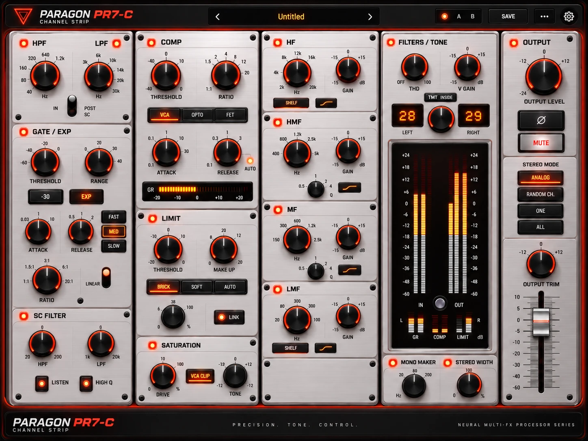

# Paragon PR7-C

[](https://github.com/ARYEZ/Paragon-PR7-C/actions/workflows/build.yml)
[](https://github.com/ARYEZ/Paragon-PR7-C/releases/latest)

A console **channel strip** VST3 plugin: filters, gate/expander, compressor, limiter, saturation, a four-band EQ, console colour and stereo tools in one window. Part of the Paragon PR7 family (PR7-G guitar, PR7-B bass, PR7-V vocals). Built with [JUCE](https://juce.com).



*The concept design. The plugin is being built towards it module by module; see [CLAUDE.md](CLAUDE.md) for the plan.*

## Building

```
cmake -B build
cmake --build build --config Release
```

The VST3 is in `build/ParagonPR7C_artefacts/Release/VST3/`. Tests: `ctest --test-dir build -C Release`.

## License

GNU AGPLv3 (see [LICENSE.md](LICENSE.md)), as required by JUCE's open-source license. The Inter typeface is under the SIL Open Font License (`resources/fonts/OFL-LICENSE.txt`).
